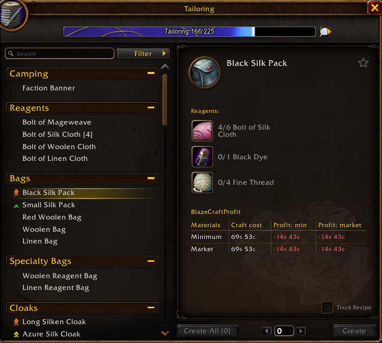
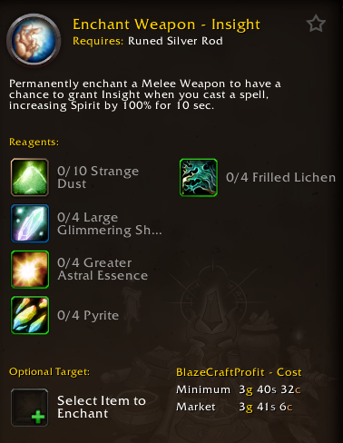
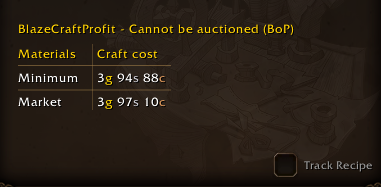

# BlazeCraftProfit

Crafting costs and estimated auction profits inside the WoW Forever professions interface, using [Goldwright](https://www.curseforge.com/wow/addons/goldwright) prices.

The selected recipe shows two material costs: minimum auction prices and market value.
For auctionable items, each cost has two profits, selling the full craft at minimum or market value, after the AH fee.
Positive profit is green; negative profit is red. Hover the panel for full amounts and details.

Direct enchants show a compact cost display beside the target item slot. Craftable items
within Enchanting retain the full profit table.

Bind on Pickup items show a **Cannot be auctioned (BoP)** heading and crafting costs,
without profit columns.

Vendor purchase prices take priority in both cost calculations. Opening a merchant records
money-only, unlimited-stock offers at their per-item price. Prices are saved per character,
including the discount offered on that visit. Until a price is learned, Goldwright prices apply.
Owned materials still count at their full price. Missing required prices show **Unknown**.

Install alongside [**Goldwright**](https://www.curseforge.com/wow/addons/goldwright) and its appropriate price data. Without auction data, known
vendor material costs can still be shown, but auction-dependent values remain unknown.

Amounts are per craft, not per individual output item or the selected batch size.
Profit includes the auction house's sales fee. Deposits and failed auctions are not included.
